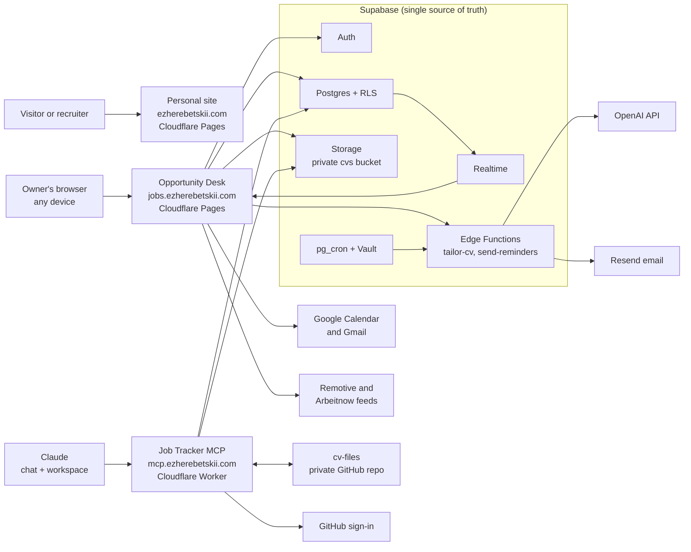
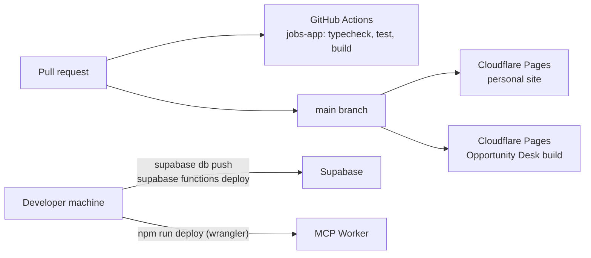

# System architecture

`ezherebetskii.com` is three products on one domain: a static personal site, **Opportunity
Desk** (a private job-search workspace), and the **Job Tracker MCP server** that lets Claude
work with the same data. Supabase is the single source of truth; Cloudflare serves everything
public; GitHub holds the code.

Last reviewed: 19 October 2026.

## Contents

- [System at a glance](#system-at-a-glance)
- [Components](#components)
- [Domains and DNS](#domains-and-dns)
- [Personal site](#personal-site)
- [Opportunity Desk](#opportunity-desk)
- [Supabase backend](#supabase-backend)
- [Job Tracker MCP server](#job-tracker-mcp-server)
- [External services](#external-services)
- [Key flows](#key-flows)
- [Security model](#security-model)
- [Build, deploy and CI](#build-deploy-and-ci)
- [Repository layout](#repository-layout)
- [Known gaps and open decisions](#known-gaps-and-open-decisions)
- [Related documents](#related-documents)

## System at a glance



The personal site is public and has no backend. Opportunity Desk and the MCP server are private
clients of the same Supabase project, so a change made in one appears in the other.

## Components

| Component | What it is | Runs on | Address | Source |
| --- | --- | --- | --- | --- |
| Personal site | Static executive profile page | Cloudflare Pages | `ezherebetskii.com`, `www.ezherebetskii.com` | `index.html`, `styles.css`, `assets/` |
| Opportunity Desk | React single-page app for the job search | Cloudflare Pages | `jobs.ezherebetskii.com` | `jobs-app/` |
| Database and auth | Postgres with row-level security, Auth, Realtime, Storage | Supabase | Supabase project URL | `supabase/migrations/` |
| Edge Functions | Server work that needs private keys | Supabase (Deno) | `/functions/v1/tailor-cv`, `/functions/v1/send-reminders` | `supabase/functions/` |
| Scheduler | Hourly reminder trigger | Supabase pg_cron | n/a | migration `20260804171000` |
| Job Tracker MCP | Claude connector for applications and CVs | Cloudflare Workers | `mcp.ezherebetskii.com/mcp` | Separate `jobs-mcp` project (see [mcp-server.md](mcp-server.md)) |
| CV files repo | Hand-off point for CV files edited by Claude | GitHub (private) | `cv-files` | n/a |

## Domains and DNS

All DNS for `ezherebetskii.com` is managed in Cloudflare.

| Name | Points to | Purpose |
| --- | --- | --- |
| `ezherebetskii.com` | Cloudflare Pages (personal site) | Main executive homepage |
| `www.ezherebetskii.com` | Same Pages project | Alias of the homepage |
| `jobs.ezherebetskii.com` | Cloudflare Pages (Opportunity Desk) | Private job-search workspace; also reachable on its `*.ezherebetskii-jobs.pages.dev` preview hosts |
| `mcp.ezherebetskii.com` | Cloudflare Worker custom domain | Job Tracker MCP endpoint |
| `contact@ezherebetskii.com` | Cloudflare Email Routing | Published contact and security address |

## Personal site

A single static page with no build step and no JavaScript.

- **Files:** `index.html` (profile, transformation stories, contact), `styles.css`,
  `assets/images/profile.jpg`.
- **Fonts:** IBM Plex Sans from Google Fonts.
- **SEO:** title, meta description, canonical URL and Open Graph tags; the Open Graph image is the
  profile photo.
- **Calls to action:** LinkedIn profile and `mailto:contact@ezherebetskii.com`.
- **Hosting:** Cloudflare Pages deploys it from `main`. The README describes publishing the
  repository root as-is; see [Known gaps](#known-gaps-and-open-decisions).

## Opportunity Desk

A private, synchronized job-search workspace. The user signs in once on any device; no device
holds a database connection of its own.

| Layer | Choice |
| --- | --- |
| UI | React 19, TypeScript, Vite 8 (production builds ship without source maps) |
| Data | `@supabase/supabase-js` in the browser, with only the public URL and publishable key (`VITE_SUPABASE_URL`, `VITE_SUPABASE_PUBLISHABLE_KEY`) |
| Sync | Supabase Realtime on a private per-user channel `opportunity-desk:<user-id>`, plus Broadcast for deletions |
| Concurrency | Every editable row has a `version`; updates match the expected version and check that a row came back |
| Google | Google Identity Services in the browser; access tokens stay in memory and are cleared on account change |
| Tests | Vitest + Testing Library (jsdom) |

Views: Dashboard, Board, Applications, Reminders, Network, Outreach, Interviews, Analytics, CV
library (with the CV builder), Find jobs, Backup, Settings. All are reachable on mobile.

The feature-level design, the database map, the migration history and 23 review-proven
engineering rules are in [`jobs-app/DEVELOPER.md`](../jobs-app/DEVELOPER.md).

## Supabase backend

Supabase is the only source of truth for synchronized records.

**Database (Postgres 17)**

| Table | Holds |
| --- | --- |
| `jobs` | Applications: pipeline status, contacts, follow-ups, job description, email draft, linked CV |
| `cvs` | CV metadata, storage path, extracted or pasted text, tailored company |
| `job_stage_events` | Immutable status history, written by a trigger |
| `contacts`, `contact_interactions` | Networking pipeline and logged interactions |
| `interview_preps`, `star_stories` | Per-application preparation and the STAR story library |
| `cv_blocks` | Reusable CV content for the CV builder |
| `outreach_emails`, `application_sends`, `email_replies` | Gmail send history, speculative outreach, detected replies |
| `user_settings` | Preferences, timezone, reminders, public Google client ID |
| `ai_generations` | Server-only ledger for the AI daily allowance |
| `reminder_deliveries` | Server-managed deduplication of reminder emails |

- **Row-level security** on every table limits each user to their own rows. Server-only tables
  (`ai_generations`) deny all client access.
- **Triggers:** `touch_record` bumps `version` and `updated_at` on every update;
  `record_job_stage_event` writes stage history; sent outreach content is frozen by trigger.
- **Storage:** private bucket `cvs` (PDF, DOC, DOCX, TXT, RTF, max 10 MB), paths
  `<user-id>/<cv-id>/<random-id>-<filename>`, policies keyed on the first folder.
- **Migrations:** forward-only files in `supabase/migrations/`, one per change, applied with the
  Supabase CLI.

**Edge Functions**

| Function | Called by | Does | Secrets |
| --- | --- | --- | --- |
| `tailor-cv` | Opportunity Desk (signed-in user's JWT) | Verifies the user, reads only their job and CV, reserves a daily allowance, asks OpenAI for a grounded draft (no response storage, strict JSON schema), records usage | `OPENAI_API_KEY`, `SUPABASE_SECRET_KEY`; optional `OPENAI_MODEL`, `AI_DAILY_LIMIT` (default 10), `ALLOWED_ORIGINS` |
| `send-reminders` | pg_cron, hourly, via `net.http_post` with a shared secret from Vault | Collects due follow-ups for opted-in users and sends one digest per user through Resend; logs deliveries (at-least-once) | `RESEND_API_KEY`, `REMINDER_FROM_EMAIL`, `REMINDER_CRON_SECRET`, `SUPABASE_SECRET_KEY` |

## Job Tracker MCP server

A Cloudflare Worker that exposes 13 tools to Claude: 7 for applications and follow-ups, 6 for
the CV library. Claude signs in through GitHub OAuth with an allow-list. The Worker reaches
Supabase with a dedicated secret key and scopes every query to the owner's user id in code.

CV files move between Claude's workspace and the library through the private `cv-files`
repository instead of through the conversation. Full reference: [mcp-server.md](mcp-server.md).

## External services

| Service | Used by | For | Credentials live in |
| --- | --- | --- | --- |
| Supabase | Opportunity Desk, MCP | Auth, data, files, functions | Publishable key in the app bundle; secret keys in function and Worker secrets |
| Cloudflare | All | DNS, Pages hosting, Workers, Email Routing | Cloudflare account |
| GitHub | All | Code, pull requests, CI, MCP sign-in, `cv-files` | GitHub account; OAuth app and fine-grained token in Worker secrets |
| Google Calendar and Gmail | Opportunity Desk | Calendar events, sending applications with the CV attached, reply detection (`gmail.metadata`, headers only) | Public client ID in `user_settings`; access tokens in browser memory only |
| OpenAI | `tailor-cv` | AI CV tailoring drafts | Supabase function secret |
| Resend | `send-reminders` | Reminder digest emails | Supabase function secret |
| Remotive, Arbeitnow | Opportunity Desk | Public vacancy feeds for "Find jobs" | None (public APIs) |
| Anthropic Claude | Owner | Conversational access through the MCP connector | Claude account; connector token issued by the MCP Worker |

## Key flows

**Sign-in and sync**

1. The browser loads Opportunity Desk from Cloudflare Pages and signs in with Supabase Auth.
2. Every read and write goes straight to Supabase; RLS limits it to the signed-in user.
3. Realtime pushes changes to the user's other open devices; deletions travel as Broadcasts.

**Sending an application**

1. The browser obtains a short-lived Google token through Google Identity Services.
2. Gmail sends the email with the linked CV, downloaded from private Storage, attached.
3. An immutable `application_sends` row records the Gmail message id; if that write fails, a
   per-user retry queue records it later without sending again.

**AI CV tailoring**

1. The user picks an application, a CV and the job description.
2. `tailor-cv` checks the user's JWT, reserves one unit of the daily allowance and calls OpenAI.
3. The draft returns for human review; a saved version keeps the complete source CV.

**Reminders**

1. pg_cron fires hourly and calls `send-reminders` with the Vault-held shared secret.
2. The function gathers due follow-ups for users at their chosen local hour and emails one digest
   through Resend.
3. Deliveries are logged after Resend accepts them, so a failed send retries next hour.

**Claude through the MCP server**

1. Claude calls `mcp.ezherebetskii.com/mcp` with its OAuth token.
2. The Worker runs the tool against Supabase, scoped to the owner.
3. The change is a normal database write, so open Opportunity Desk tabs refresh through Realtime.

## Security model

| Boundary | Control |
| --- | --- |
| Browser → Supabase | Only the publishable key ships in the bundle; RLS on every table; ownership checks on cross-table links (`jobs.cv_id`, contact links) |
| Browser → Google | Tokens kept in memory, scoped to the signed-in Supabase user, cleared on account change; Gmail bodies never read |
| Browser → `tailor-cv` | JWT verified server-side; CORS allow-list; per-user daily limit; job and CV text treated as untrusted input |
| pg_cron → `send-reminders` | Shared secret read from Vault at execution time |
| Claude → MCP Worker | OAuth 2.1, GitHub sign-in with an allow-list, re-checked per session; 13 narrow tools, no delete or SQL |
| MCP Worker → Supabase | Dedicated secret key, every query scoped to the owner id in code |
| MCP Worker → GitHub | Fine-grained token limited to the `cv-files` repository contents; paths outside it refused |
| Secrets | Only in Supabase function secrets, Supabase Vault and Cloudflare Worker secrets; never in this repository (`.env*` is git-ignored) |

This repository is **public**. Anything committed here, including documentation, is readable by
anyone, so it must never contain keys, tokens, personal data or job-search records.

Report vulnerabilities as described in [SECURITY.md](../SECURITY.md).

## Build, deploy and CI



| What | Source | How it ships | Checks |
| --- | --- | --- | --- |
| Personal site | Repository root | Cloudflare Pages on push to `main` | None (static) |
| Opportunity Desk | `jobs-app/` | Cloudflare Pages builds `npm run build` on push to `main` | CI on every PR touching `jobs-app/`: `npm ci`, `npm run typecheck`, `npm test`, `npm run build` (Node 22) |
| Database | `supabase/migrations/` | `supabase db push` (manual) | Supabase security and performance advisors |
| Edge Functions | `supabase/functions/` | `supabase functions deploy <name>` (manual) | Review |
| MCP server | Separate `jobs-mcp` project | `npm run deploy` with Wrangler (manual) | Type-check, 24 integration tests, end-to-end run |
| Dependencies | `jobs-app/package.json`, GitHub Actions | Dependabot pull requests: npm weekly (minor and patch grouped), Actions monthly | CI |

Branches follow [CONTRIBUTING.md](../CONTRIBUTING.md): branch from `main`, one change per pull
request, CI green before merge.

## Repository layout

```text
.
├── index.html, styles.css      Personal site (static)
├── assets/images/              Site images (profile photo)
├── jobs-app/                   Opportunity Desk (React + Vite)
│   ├── src/components/         Views and forms
│   ├── src/lib/                Pure logic with unit tests
│   ├── src/data/               Supabase reads and writes
│   ├── README.md               Product overview
│   └── DEVELOPER.md            Developer handoff: design, database map, rules
├── supabase/
│   ├── migrations/             Forward-only schema history
│   └── functions/              tailor-cv, send-reminders
├── docs/
│   ├── ARCHITECTURE.md         This document
│   └── mcp-server.md           Job Tracker MCP reference
├── .github/                    CI workflow, Dependabot, PR template
├── README.md, CONTRIBUTING.md, SECURITY.md, LICENSE
```

## Known gaps and open decisions

| Item | Detail | Suggested action |
| --- | --- | --- |
| Pending migration | `20260804211000_clean_email_replies_on_source_deletion.sql` is in `main`, but production's migration list ended at `20260804210000` when checked on 19 Oct 2026 | Apply with `supabase db push` and confirm |
| Site publishes the repo root | If the `ezherebetskii.com` Pages project publishes the repository root, every file here (including `jobs-app/`, `supabase/` and `docs/`) is downloadable from the site | Set a build output folder containing only the site files, or confirm the current Pages setting |
| MCP source outside the repo | The Worker lives in a separate local project, so it has no pull requests, CI or history here | Decide whether to move it into `mcp-server/` |
| Two AI tailoring paths | `tailor-cv` (OpenAI) and Claude through the MCP server follow different rules | Keep one rulebook in Supabase that both read |
| CVs without saved text | Word files uploaded without extracted text cannot be used by `tailor-cv` | Backfill text (the MCP server can read `.docx` files) |
| Delivery table out of date | `jobs-app/DEVELOPER.md` was last reviewed on 4 Aug 2026 and still lists three phases as in progress | Re-review the phase statuses |
| Email Routing | `contact@ezherebetskii.com` is published on the site and in SECURITY.md | Confirm forwarding works end to end |

## Related documents

- [README.md](../README.md): quick start for each part of the repository.
- [jobs-app/DEVELOPER.md](../jobs-app/DEVELOPER.md): Opportunity Desk design, database map,
  migration history and engineering rules.
- [jobs-app/README.md](../jobs-app/README.md): Opportunity Desk features by view.
- [mcp-server.md](mcp-server.md): Job Tracker MCP server reference.
- [CONTRIBUTING.md](../CONTRIBUTING.md) and [SECURITY.md](../SECURITY.md).
