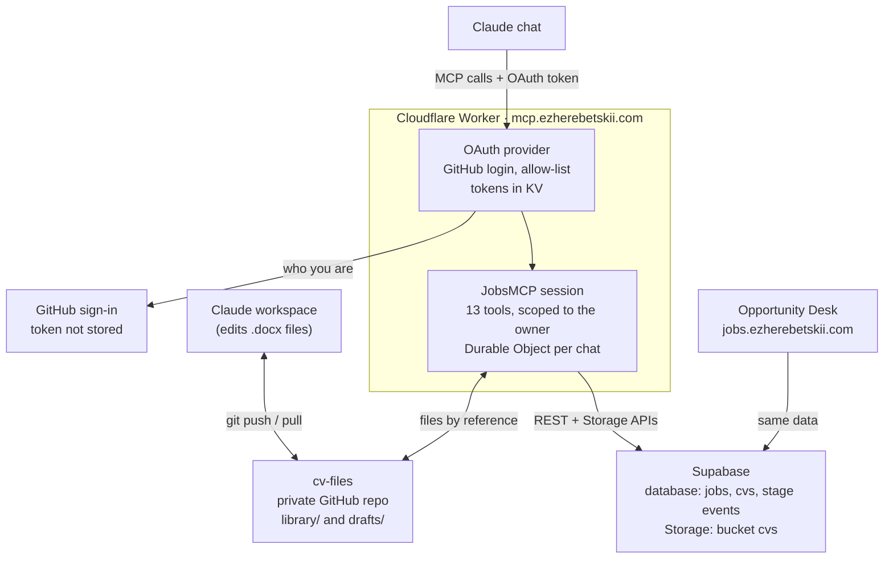

# Job Tracker MCP server

The Job Tracker MCP server lets Claude read and update Opportunity Desk data from a
conversation: applications, follow-ups, interview notes and the CV library. It is a private
server; only allow-listed GitHub accounts can connect.

| Item | Value |
| --- | --- |
| Endpoint | `https://mcp.ezherebetskii.com/mcp` |
| Version | 1.2.0 (19 October 2026) |
| Runs on | Cloudflare Workers, one Durable Object per Claude session |
| Data | The production Supabase project behind `jobs.ezherebetskii.com` |
| Sign-in | GitHub OAuth with an allow-list |
| CV file transfer | A private GitHub repository (`cv-files`) |
| Tools | 13: 7 for applications, 6 for the CV library |
| Source code | Maintained outside this repository (`jobs-mcp` Worker project) |

What it does not do: delete anything, run raw SQL, or read another user's data.

See [ARCHITECTURE.md](ARCHITECTURE.md) for where the server sits in the whole system.

## Contents

- [Architecture](#architecture)
- [Tool reference: applications](#tool-reference-applications)
- [Tool reference: CV library](#tool-reference-cv-library)
- [Everyday use](#everyday-use)
- [Setup and configuration](#setup-and-configuration)
- [Security model](#security-model)
- [Operations](#operations)
- [Troubleshooting](#troubleshooting)
- [Development and testing](#development-and-testing)
- [Changelog and roadmap](#changelog-and-roadmap)

## Architecture

One Cloudflare Worker sits between Claude and the data. Opportunity Desk keeps talking to
Supabase directly, so both always see the same records.

What happens on one tool call:

1. Claude sends the call to `/mcp` with the OAuth token it received at sign-in.
2. The OAuth provider checks the token and hands the call to the user's `JobsMCP` session.
3. The session runs the tool against Supabase with a key that the code limits to the owner's user id.
4. CV files travel between the session and the `cv-files` repository, never through the chat.
   The Claude workspace pushes and pulls them with git.

## Tool reference: applications

Seven tools read and write the `jobs` table and its related tables. Read tools are marked
read-only, so Claude can call them without asking.

| Tool | What it does | Key inputs |
| --- | --- | --- |
| `list_applications` | Search by company or role words; filter by status or active only; sort by updated, applied or next action | `query`, `status[]`, `active_only`, `sort`, `limit` (max 100) |
| `get_application` | One application with notes, stage history, linked contacts, interview prep and the linked CV | `id`, `include_job_description` |
| `add_application` | Creates an application; returns a likely duplicate (same company and role, or same job link) instead of creating it | `company`, `role_title`, `status`, any field, `cv_id`, `allow_duplicate` |
| `update_application` | Changes status, next action and due date, adds a dated note, corrects fields, links a CV | `id`, any field, `append_note`, `clear_fields[]`, `expected_version` |
| `get_follow_ups` | Overdue and upcoming next actions on applications and contacts, plus in-progress roles that have gone quiet | `days_ahead` (default 7), `stale_after_days` (default 14), `include_contacts` |
| `pipeline_summary` | Counts by status, applications in the last 7 and 30 days, response rate, open high-priority roles | none |
| `save_interview_notes` | Research and questions for an interview; post-interview notes are appended with the date | `application_id`, `research_notes`, `questions_to_ask`, `append_post_interview_note` |

Rules every write follows:

- **Statuses:** `saved`, `applied`, `phone_screen`, `interviewing`, `assessment`, `final_round`,
  `offer`, `accepted`, `rejected`, `withdrawn`, `on_hold`, `closed`. Finished = accepted,
  rejected, withdrawn, closed.
- **Stage history:** every status change is logged in `job_stage_events` by the existing
  database trigger.
- **Applied date:** moving to `applied` fills `applied_at` with today if it is empty.
- **Dates:** times are shown in Europe/Budapest. A date without a time (`2026-10-26`) means
  09:00 local, so reminder emails arrive that morning.
- **Notes:** `append_note` adds `[YYYY-MM-DD] text` as a new line; `replace_notes` is only for
  an explicit rewrite.
- **Clearing:** a field is emptied only when listed in `clear_fields`; an empty string is ignored.
- **Concurrent edits:** every write checks the record's `version`. If Opportunity Desk changed it
  a moment earlier, the tool re-reads and re-applies once, so nothing is overwritten.
- **No delete:** close an application with `withdrawn`, `rejected` or `closed`.

## Tool reference: CV library

Six tools manage the `cvs` table and its files in the private Storage bucket `cvs`. CV files
never pass through the conversation: they move by reference, at about 100 tokens instead of
about 29,000 for a base64 copy of a typical Word CV.

| Tool | What it does | Key inputs |
| --- | --- | --- |
| `list_cvs` | Search by name, target role, company or file name; shows file or text-only and the applications each CV was used for | `query`, `limit` |
| `get_cv` | Details and full text; uses the saved text, otherwise reads the Word (.docx) file. `.doc` and `.pdf` files return a note instead | `id` |
| `save_cv` | Adds a new CV version, optionally attached to an application. Word text is saved automatically | `name`, `github_path` or `file_url` or `text`, `attach_to_application_id` |
| `update_cv` | Renames, changes target role or company, adds a dated note, replaces or clears the saved text. The file is unchanged | `id`, fields, `append_note`, `clear_fields[]` |
| `get_cv_download_link` | Signed link that downloads the file under its original name | `id`, `expires_minutes` (default 60, max 1,440) |
| `copy_cv_to_github` | Copies a CV's original file into `cv-files` so it can be edited with its formatting intact | `id`, `path` (default `library/<id>-<file name>`) |

How `save_cv` gets the file, in order of preference:

1. `github_path`: a path in the `cv-files` repository (for example `drafts/CV_Acme_PMO.docx`) or
   its github.com link. Links to any other repository are refused.
2. `file_url`: an https link, public or pre-signed.
3. `file_base64`: last resort for tiny files only.

Every file must be 5 MB or less and of type `.docx`, `.pdf`, `.doc`, `.txt` or `.rtf`. Its first
bytes must match the claimed type, so a web page cannot pose as a `.docx`. Saved files go to
`<user id>/<cv id>/<uuid>-<file name>`, the same layout Opportunity Desk uses. Existing CVs and
files are never overwritten.

## Everyday use

Talk to Claude normally and name the company; it finds the right record. New tools appear only
in chats started after a deploy.

| Situation | What to say |
| --- | --- |
| Morning check | "What do I need to follow up on today?" |
| After any event | "Acme PMO Lead: recruiter call went well, panel Thursday 14:00." |
| New application | "I applied to this today: [job ad + link]." |
| Closing one | "Close Globex, no response" or "Initech rejected me." |
| Overview | "How's my search going?" |
| Interview prep | "Prep notes for the Acme interview: …", later "Acme round 1: they asked about …" |
| Find a CV | "Which CVs do I have for PMO roles?" |
| Read a CV | "Show me my Globex CV." |
| Record what was sent | "I sent the generic CV to Initech." |
| Get the file | "Give me a download link for the Acme CV." |

Tailoring a CV with its formatting intact, without spending tokens on the file:

1. Ask: "Copy my Globex CV to the repo, tailor it for [role at company], and save it."
2. `copy_cv_to_github` puts the original `.docx` in `cv-files/library/`.
3. Claude pulls the repository in its workspace, edits the `.docx`, and pushes it to `drafts/`.
4. `save_cv` with `github_path` stores it as a new CV, saves its text and attaches it to the
   application.
5. Ask for a download link when the file is needed for an application form.

Claude needs push access to `cv-files` in the chat where tailoring happens; it asks to attach the
repository the first time.

## Setup and configuration

Everything is configured in the Worker's `wrangler.jsonc` (non-secret settings) and in
Cloudflare Worker secrets.

**Settings in `wrangler.jsonc`**

| Setting | Purpose |
| --- | --- |
| `SUPABASE_URL` | Production Supabase project URL |
| `OWNER_USER_ID` | The Supabase user whose records the tools read and write; every query is limited to it |
| `ALLOWED_GITHUB_LOGINS` | GitHub logins allowed to sign in (comma-separated) |
| `TIMEZONE` | `Europe/Budapest`: display times and the 09:00 default |
| `CV_FILES_REPO` | Repository used to move CV files (`owner/cv-files`) |
| `CV_FILES_BRANCH` | Branch in that repository (`main`) |
| KV binding `OAUTH_KV` | OAuth sign-in state and tokens |
| Durable Object `JobsMCP` | One MCP session per connection (migration `v1`) |
| Route | `mcp.ezherebetskii.com` as a custom domain |
| Compatibility flags | `nodejs_compat`, `global_fetch_strictly_public` (blocks calls to private networks) |

**Secrets** (set with `npx wrangler secret put <NAME>`, one command at a time)

| Secret | Where it comes from |
| --- | --- |
| `SUPABASE_SECRET_KEY` | Supabase → Project Settings → API Keys → Secret keys → a dedicated key named `jobs-mcp` |
| `GITHUB_CLIENT_ID` | GitHub OAuth app "Job Tracker MCP" |
| `GITHUB_CLIENT_SECRET` | Same app → Generate a new client secret |
| `COOKIE_ENCRYPTION_KEY` | Random value: `node -e "console.log(require('crypto').randomBytes(32).toString('hex'))"` |
| `CV_FILES_GITHUB_TOKEN` | Fine-grained token limited to the `cv-files` repository, Contents: Read and write |

**Outside Cloudflare**

- GitHub OAuth app "Job Tracker MCP": homepage `https://mcp.ezherebetskii.com`, callback
  `https://mcp.ezherebetskii.com/callback`.
- Private GitHub repository `cv-files` with folders `library/` (copies from the library) and
  `drafts/` (edited versions).
- A Claude custom connector pointing at `https://mcp.ezherebetskii.com/mcp`.

## Security model

Only allow-listed GitHub accounts can get a token, and the server can reach only the owner's
records, with no delete or SQL tool.

- **Sign-in:** OAuth 2.1 with dynamic client registration and URL-based client ids. After GitHub
  sign-in the server checks the login against `ALLOWED_GITHUB_LOGINS`; any other account sees
  "Access denied" and gets no token. The GitHub sign-in token is used once to read the identity
  and is not stored.
- **Second check:** each new session re-checks the allow-list and exposes no tools to anyone else.
- **Database key:** `SUPABASE_SECRET_KEY` bypasses row-level security, so the code scopes every
  read and write to `OWNER_USER_ID`. It is a dedicated key that can be revoked on its own.
- **Narrow tools:** 13 tools with validated inputs. No delete, no raw SQL, no access to other
  tables.
- **CV files repository:** the token reaches only `cv-files` and only its contents. The server
  refuses paths that leave the repository and links to other repositories.
- **Downloads by link:** https only, 5 MB cap, type checked against the file's first bytes.
  Calls to private network addresses are blocked by `global_fetch_strictly_public`.
- **Download links:** signed and time-limited (60 minutes by default). Anyone holding a link can
  download until it expires, so links are shown only to the owner.
- **Secrets:** stored only as Cloudflare secrets, never in code or a repository; `.dev.vars` is
  git-ignored.

## Operations

All commands run from the Worker project folder. Secrets survive every redeploy.

| Task | How |
| --- | --- |
| Install a new version | Copy the new files over the project folder (keep your `wrangler.jsonc`), run `npm run deploy`, start a new Claude chat |
| Watch live logs | `npx wrangler tail`, then use the connector; errors show with their cause |
| Check the endpoint | Open `https://mcp.ezherebetskii.com`: "This is a private MCP endpoint" |
| Rotate the Supabase key | Create a new secret key in Supabase → `npx wrangler secret put SUPABASE_SECRET_KEY` → delete the old key |
| Rotate the GitHub OAuth secret | Generate a new client secret → `npx wrangler secret put GITHUB_CLIENT_SECRET` → delete the old secret |
| Renew the CV files token | Before it expires: regenerate it on GitHub → `npx wrangler secret put CV_FILES_GITHUB_TOKEN` |
| Allow another GitHub account | Add it to `ALLOWED_GITHUB_LOGINS`, then `npm run deploy` |
| Cut all access | Remove the connector in Claude, revoke the `jobs-mcp` key in Supabase, or run `npx wrangler delete` |

When pasting a secret, run one command, wait for "Enter a secret value", paste only the value and
press Enter. Pasting several lines at once saves the next command as the secret.

## Troubleshooting

Most failures are a wrong secret; `npx wrangler tail` names the cause in one line.

| Symptom | Cause | Fix |
| --- | --- | --- |
| "Sign-in failed" after GitHub login; log shows `incorrect_client_credentials` | Wrong GitHub client ID or secret | Re-enter `GITHUB_CLIENT_ID` and a newly generated `GITHUB_CLIENT_SECRET` |
| Log shows `redirect_uri_mismatch` | Callback in the GitHub app differs | Set it to exactly `https://mcp.ezherebetskii.com/callback` |
| "Access denied" after GitHub login | The account isn't allow-listed | Check `ALLOWED_GITHUB_LOGINS`, redeploy |
| Tools answer "The server's Supabase key was rejected" | Bad `SUPABASE_SECRET_KEY`, e.g. the command text was pasted as the value | Re-enter the key alone |
| "GitHub file transfer is not set up" | `CV_FILES_GITHUB_TOKEN` missing | Set the token; no redeploy needed |
| "GitHub refused access" / "refused the write" | Token expired or lacks Contents: Read and write on `cv-files` | Regenerate the token with that permission |
| "No file at drafts/… in owner/cv-files" | The file wasn't pushed, or the path or branch differs | Push first; check the path |
| New tools don't appear | The chat loaded the old tool list | Start a new chat |
| Deploy fails on the custom domain | A DNS record `mcp` already exists | Delete it in Cloudflare DNS, redeploy |
| Deploy complains about `OAUTH_KV` | Duplicate or placeholder KV entry | Keep one entry with the id from `wrangler kv namespace create OAUTH_KV` |
| `get_cv` returns no text for a `.doc` or `.pdf` | Only Word `.docx` files are read | Use `get_cv_download_link`, or save a `.docx` version |

## Development and testing

The code is TypeScript with no database client library: Supabase is called through its REST and
Storage APIs directly, so every request is visible in one file.

| File | Role |
| --- | --- |
| `src/index.ts` | Worker entry: OAuth provider, `JobsMCP` session, tool registration |
| `src/auth/github-handler.ts` | GitHub sign-in, allow-list check, approval page |
| `src/auth/access.ts` | Allow-list logic and the identity kept in the token |
| `src/auth/workers-oauth-utils.ts` | Cloudflare's CSRF and state helpers (MIT licence) |
| `src/tools.ts` | The 7 application tools and the server instructions |
| `src/cv-tools.ts` | The 6 CV library tools |
| `src/db.ts` | Supabase REST and Storage clients |
| `src/files.ts` | GitHub repository transfer, https downloads, file-type checks |
| `src/docx.ts` | Word `.docx` to text (ZIP reader + WordprocessingML) |
| `src/dates.ts` | Time-zone handling for Europe/Budapest |
| `test/` | Integration tests, schema replica, end-to-end harness |

Checks to run before a deploy:

1. `npm run type-check`: TypeScript, strict mode.
2. `npm test`: 24 integration tests. A real MCP client calls the tools against real PostgREST and
   Postgres, loaded with `test/fixtures/schema.sql` (a replica of the tracker tables and
   triggers). Storage and GitHub are faked in memory. Needs a local Postgres plus PostgREST on
   port 3399 with `db-anon-role = "service_role"`.
3. `node test/e2e/run.mjs`: runs the real Worker under `wrangler dev -c test/e2e/wrangler.jsonc`
   with a fake login. It drives sign-in, token, tools, Word text reading and CV upload inside the
   Cloudflare runtime; `test/e2e/rest-proxy.mjs` stands in for Supabase.

None of the tests touch the live database, storage or repositories.

## Changelog and roadmap

| Date | Version | Change |
| --- | --- | --- |
| 19 Oct 2026 | 1.2.0 | CV files by reference: `save_cv` takes `github_path` or `file_url`; new `copy_cv_to_github`; file-type checks and 5 MB cap |
| 19 Oct 2026 | 1.1.0 | CV library: `list_cvs`, `get_cv` (reads Word files), `save_cv`, `update_cv`, `get_cv_download_link`; `cv_id` on applications |
| 19 Oct 2026 | 1.0.0 | First release: 7 application tools, GitHub sign-in, custom domain, URL-based client ids |

Open items:

- [ ] Confirm the GitHub round trip live (`copy_cv_to_github` → edit → `save_cv`).
- [ ] One tailoring rulebook stored in Supabase and used by both Claude (MCP) and the
      `tailor-cv` Edge Function.
- [ ] Save text for Word-only CVs so the `tailor-cv` function works on every CV.
- [ ] Direct Supabase upload links instead of the GitHub hop, if Claude's workspace is allowed
      to reach the Supabase domain.
- [ ] Networking tools for the `contacts` table (add a contact, log an interaction).
- [ ] Decide whether the Worker's source moves into this repository (for example `mcp-server/`).
